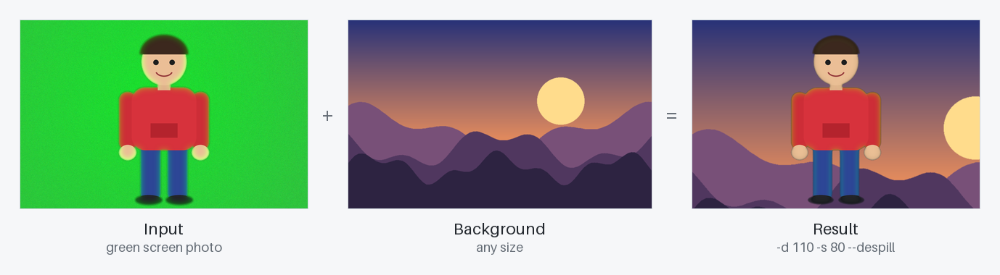
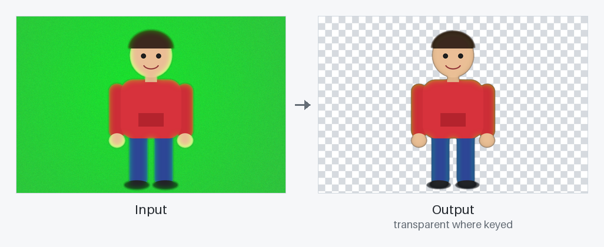
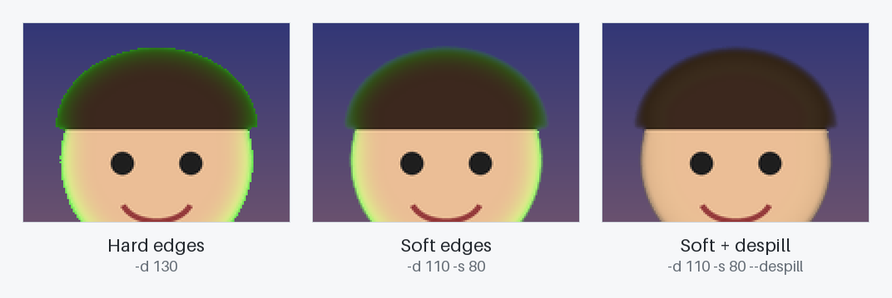
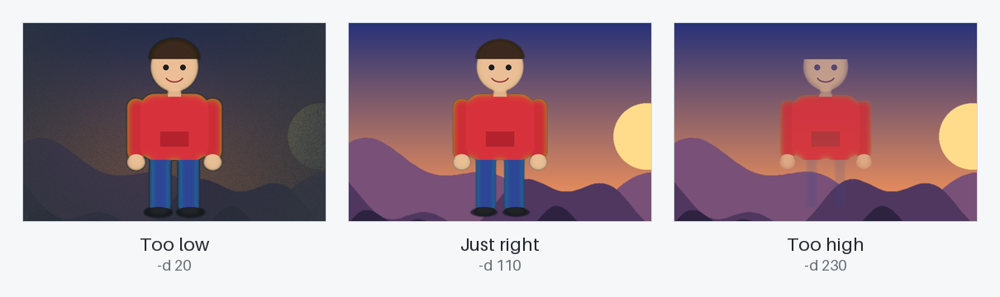
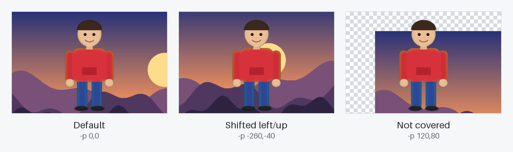

# Chroma Key


A command-line green-screen tool in plain Java. It removes a solid background color
from a photo and replaces it with another image, or makes it transparent.



## Contents

- [Quick start](#quick-start)
- [Usage](#usage)
- [Features](#features)
  - [Replace the background](#replace-the-background)
  - [Transparent output](#transparent-output)
  - [Soft edges and despill](#soft-edges-and-despill)
  - [Choosing a tolerance](#choosing-a-tolerance)
  - [Positioning the background](#positioning-the-background)
- [How it works](#how-it-works)
- [Error handling](#error-handling)
- [Project structure](#project-structure)

## Quick start

Requires a JDK 11 or newer. Sample images are included in [`examples/`](examples).

```bash
git clone <this-repo-url>
cd chroma-key-java

javac -d out src/chromakey/*.java
java -cp out chromakey.Main -i examples/greenscreen.png -o result.png \
  -c "0,255,0" -d 110 -s 80 --despill -b examples/background.png
```

## Usage

```
java -cp out chromakey.Main -i <input> -o <output.png> -c <color> -d <distance> [-s <softness>] [--despill] [-b <background>] [-p <x,y>]
```

| Option | Required | Description | Example |
|:------:|:--------:|-------------|---------|
| `-i` | ✅ | Input image (the photo with the green background) | `photo.jpg` |
| `-o` | ✅ | Output image, must end in `.png` | `result.png` |
| `-c` | ✅ | Key color as `R,G,B`, `R G B`, `#RRGGBB` or `#RGB` | `"0,255,0"`, `"#00FF00"` |
| `-d` | ✅ | Distance (tolerance), a number `≥ 0` | `110` |
| `-s` | | Softness: width of the blended edge band beyond `-d`. Default `0` (hard edges) | `80` |
| `--despill` | | Remove the key color's tint from the subject | |
| `-b` | | Background image. Without it, keyed pixels become transparent | `beach.jpg` |
| `-p` | | Background offset `x,y`, negative values allowed. Default `0,0` | `-50,30` |
| `-h` | | Show help | |

Input images can be any format `ImageIO` reads: PNG, JPEG, BMP, GIF or WBMP.

## Features

### Replace the background

Every pixel close enough to the key color is replaced with the pixel at the same
position in the background image.

```bash
java -cp out chromakey.Main -i examples/greenscreen.png -o result.png \
  -c "0,255,0" -d 110 -s 80 --despill -b examples/background.png
```

### Transparent output

Leave out `-b` and the keyed pixels become fully transparent, so the result can be
placed on top of anything later.

```bash
java -cp out chromakey.Main -i examples/greenscreen.png -o cutout.png -c "#00FF00" -d 110 -s 80 --despill
```



### Soft edges and despill

In real photos the edge of the subject is a few pixels wide and partly green, and
green light from the screen reflects onto the subject (*spill*). A plain cut leaves
a jagged green outline.



- **`-s <softness>`** turns the cut into a gradient. Pixels closer than `-d` are fully
  replaced, pixels between `-d` and `-d + -s` are mixed with the background, and
  pixels farther away are kept. With no background those edge pixels become
  semi-transparent, so the cutout composites cleanly later.
- **`--despill`** removes the green tint from everything that is kept. The key's
  strongest channel (green for a green screen) is limited to the average of the other
  two, so greenish edges turn neutral while skin, hair and clothes stay unchanged.

They work best together. Despill also affects subject colors that are close to the
key color, so leave it off if the subject wears green.

### Choosing a tolerance

`-d` controls how far a color may be from the key color and still count as
"green screen". Real green screens are never one flat color, so some tolerance is
always needed.



All three use `-s 80 --despill`.

| Distance | Effect |
|----------|--------|
| Too low | The screen is only partly removed and stays as a dark haze |
| Just right | The whole screen is removed and the subject is untouched |
| Too high | The subject fades out too (here the hair and jeans vanish) |

`-d 100`–`150` with `-s 50`–`100` is a good starting point for a typical green
screen. The largest possible distance is about `441.67` (black to white).

### Positioning the background

The background is never stretched. Its top-left corner is placed at the `-p` offset
relative to the input image, and the output always has the size of the input image.



- **Larger background:** only the overlapping part is used. Use a negative offset to
  pick which part, e.g. `-p -260,-40` moves the sun behind the subject.
- **Smaller background or a gap from the offset:** keyed pixels the background does
  not cover become transparent.

## How it works

For each pixel the program computes the Euclidean distance between its color and the
key color:

```
distance = √((R₁ − R₂)² + (G₁ − G₂)² + (B₁ − B₂)²)
```

| Condition | Result pixel |
|-----------|--------------|
| `distance < d` | Background pixel at `(x − offsetX, y − offsetY)`, or transparent if no background covers it |
| `d ≤ distance < d + s` | Original pixel drawn over that replacement with opacity `(distance − d) / s` |
| `distance ≥ d + s` | Original pixel |

With `--despill`, every pixel that is kept (fully or partly) first has its key channel
limited: for a green key, `G = min(G, (R + B) / 2)`.

The result is always written as a 32-bit ARGB PNG.

## Error handling

The program stops with a clear message instead of a stack trace.

| Exit code | When |
|:---------:|------|
| `0` | Success |
| `1` | A required option is missing, an option is unknown, or a color, distance or position is malformed |
| `2` | An image is missing, unreadable or in an unsupported format, or the output cannot be written |

```
$ java -cp out chromakey.Main -i photo.jpg -o out.png -c "#00FG00" -d 100
Error: Invalid hex color "#00FG00". Use "#RRGGBB" (e.g. #00FF00).
```

## Project structure

```
chroma-key-java/
├── src/chromakey/
│   ├── Main.java          entry point, file I/O and error reporting
│   ├── ArgsParser.java    command-line parsing and validation
│   ├── ChromaKeyer.java   keying, soft edges and despill
│   └── ColorUtils.java    color parsing, RGB distance and alpha blending
├── examples/              sample green screen photo and background
└── docs/images/           images used in this README
```
